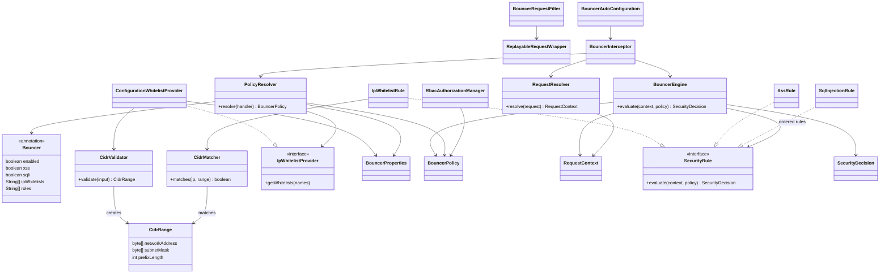
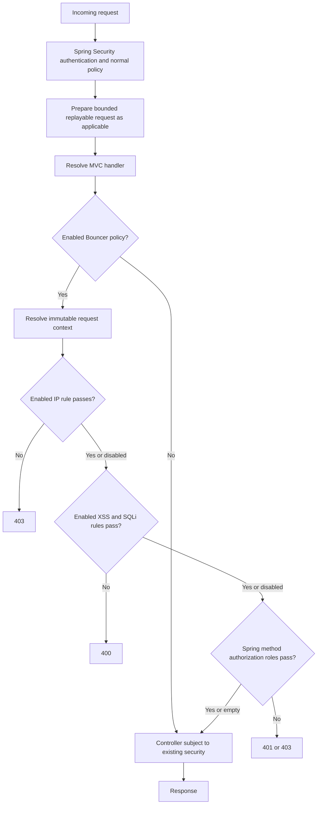

# Bouncer architecture (design, not implementation)

Bouncer is an annotation-driven defense-in-depth library for synchronous Spring MVC JSON REST APIs. It does not replace parameterized SQL, context-aware output encoding, sanitization, Spring Security, or an edge WAF. No claim of comprehensive injection detection is made.

## Proposed annotation API

```java
@Bouncer(
    enabled = true,
    xss = true,
    sqli = true,
    ipWhitelists = {"internal-services", "trusted-partners"},
    roles = {"ADMIN", "DEVELOPER"}
)
```

Defaults: enabled, xss, sqli = true; both arrays empty. Nonempty roles enable Bouncer's additional RBAC check (any matching verified role; define ROLE_ convention). Nonempty ipWhitelists enable IP checks (union of all named groups, OR within union); all enabled protections must pass. Global or annotation disable bypasses Bouncer only, not existing Spring Security.

```yaml
bouncer:
  enabled: true
  ip-whitelists:
    internal-services:
      - 192.168.1.0/24
      - 10.0.0.15
    trusted-partners:
      - 10.20.0.0/16
      - 2001:db8::/32
```

## UML class diagram



## Request flow



Filter ordering and handler-specific body handling must be verified in integration tests. A filter runs before handler mapping; do not reject unannotated endpoints merely because of Bouncer. MVC interceptor performs WAF checks; use Spring Security method authorization for RBAC.

## Pseudocode

```text
validate(input):
    reject null/blank, malformed literal, multiple slashes or empty suffix
    parse IP literal without DNS
    determine family (32 or 128 bits)
    use full prefix when absent; validate decimal prefix bounds
    mask = prefixMask(prefix, bitLength)
    reject when (address AND mask) != address
    return immutable CidrRange with defensive copies

matches(clientIp, range):
    parse literal without DNS; reject malformed or incompatible family
    return (clientBytes AND range.mask) == range.network

resolveWhitelists(names):
    for each name:
        reject missing or empty group
        validate every range; reject /0 by default at allowlist policy layer
        union entries into immutable set
    return set

resolvePolicy(annotation):
    if globally disabled or annotation absent/disabled: return disabled
    resolve all named whitelists if present
    validate roles; enable RBAC only for nonempty roles
    return immutable policy (cache validated policies at startup)

resolveRequest(request):
    snapshot URI, method, path variables, query parameters, all headers
    read bounded replayable body bytes; distinguish unsupported formats
    derive client IP only from trusted peer/proxy configuration
    snapshot verified authorities; ignore arbitrary role headers
    return immutable context

evaluate(context, policy):
    if policy disabled: allow
    for rule in ordered injected rules:
        if enabled:
            decision = rule.evaluate(context, policy)
            if denied: return decision
    return allow
    on evaluation failure: fail closed with safe internal error
```

## Security contracts

- Strict CIDR canonical networks; IPv4 /32 and IPv6 /128 for individual addresses. Reject ambiguous mapped IPv6 forms in initial version. Reject /0 by default at policy layer, not because syntax is invalid.
- No DNS lookups for configured or client IP literals. Never trust arbitrary forwarding headers; use explicit trusted proxy configuration.
- Unknown or empty selected groups and malformed CIDRs fail startup where possible; never silently disable a configured restriction.
- Preserve repeated values, body bytes and immutable snapshots; bound body size, parsing depth and inspection work. Start with synchronous JSON; multipart, streaming and WebFlux are outside initial scope.
- Use maintained detectors where feasible; false positives and bypasses must be regression-tested. Do not log raw bodies, credentials, tokens or matched signatures.
- Use 400 for detected suspicious input, 401 for missing authentication, 403 for IP/role denial, 413 for oversized supported body, 415 for unsupported required inspection, 500 for internal security failure.
- Keep core Java-only; Spring adapters inject dependencies. Strategy, Chain of Responsibility, Facade, Adapter and dependency injection.

## Suggested modules

- bouncer-core: network, model, rules, engine
- bouncer-spring-boot-starter: annotation, properties, resolver, filter, wrapper, interceptor, authorization, autoconfigure
- bouncer-example-api: integration and consumer examples

Do not create production Java classes ahead of their failing tests.
